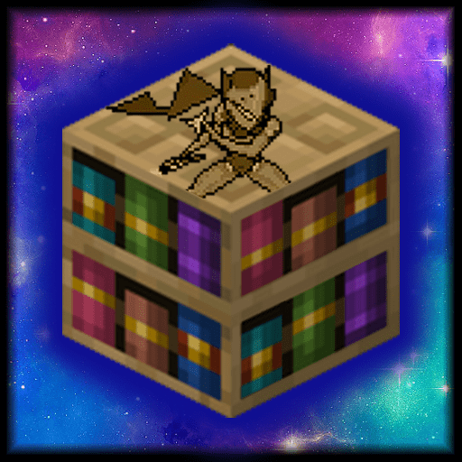

<div align="center">



# BorisLib

**The server-side Fabric toolkit behind Arcana Novum and Ancestral Archetypes.<br/>GUIs, configs, persistent data, stackable conditions, cutscenes and more. Players don't need any mods.**

[](https://modrinth.com/mod/boris-lib)
[](https://modrinth.com/mod/boris-lib/versions)
[](https://github.com/borisshoes/BorisLib/releases/latest)
[](#using-borislib-in-your-mod)

[](https://discord.gg/dTKPeNEg6r)
[](https://modrinth.com/mod/fabric-api)
[](#installation)
[](LICENSE)

</div>

BorisLib is a Fabric library for mods that run entirely on the server. It collects the systems that my larger mods kept needing: chest GUIs with pages, sorting and filtering, a config file with generated commands, data storage for players, worlds and the server, a status effect system that stacks like attributes, scripted camera cutscenes, timers, particle shapes and a large set of utility methods. It is built on [Polymer](https://github.com/Patbox/polymer) and [sgui](https://github.com/Patbox/sgui), so vanilla clients can join without installing anything.

## Contents
- [Features](#features)
- [Installation](#installation)
- [Using BorisLib in Your Mod](#using-borislib-in-your-mod)
- [API Guide](#api-guide)
  - [Config](#config)
  - [Data Storage](#data-storage)
  - [Conditions](#conditions)
  - [GUIs](#guis)
  - [Sequences and Cutscenes](#sequences-and-cutscenes)
  - [Timers](#timers)
  - [Login Callbacks](#login-callbacks)
  - [Events](#events)
  - [Movement Tracker](#movement-tracker)
  - [Particle Effects](#particle-effects)
  - [Utilities](#utilities)
- [Commands](#commands)
- [Configuration](#configuration)
- [Permission Nodes](#permission-nodes)
- [Building from Source](#building-from-source)
- [Mods Built with BorisLib](#mods-built-with-borislib)
- [Support and Contributing](#support-and-contributing)
- [Translation Credits](#translation-credits)
- [License](#license)

The API Guide is long. Use the outline button at the top right of this file on GitHub to jump to a specific section.

## Features
- **Server-side GUIs.** `PagedGui` turns any list into a chest menu with pages, sort and filter buttons. `GraphicalItem` supplies over 60 textured, dyeable GUI icons that fall back to vanilla items for players without the resource pack.
- **Config manager.** Declare typed settings once and get a `.properties` file with comments, a generated `/yourmod config` command with tab completion and validation, and a permission node for every setting.
- **Data storage.** Attach your own data to a player, a dimension or the whole server with one registered key. Player data can be read while the player is offline, and every scope has crash-safe backups.
- **Conditions.** A status effect system with the granularity of entity attributes. Several sources can apply the same condition, instances stack or compete by rule, and opposing conditions cancel out. 31 conditions are built in.
- **Sequences.** Scripted camera cutscenes along keyframed paths (across dimensions if needed), invincibility-frame animations and ghost-spectator respawn phases. The player's state is restored after a disconnect, death or crash.
- **Timers and login callbacks.** Run code after a delay, on an interval, or the next time a specific player logs in, even after a restart.
- **Game events.** A short-lived event log for questions like "did this player hit that mob in the last 5 seconds?"
- **Movement tracker.** An estimate of each player's real velocity on the server, with no custom packets.
- **Particle effects.** Lines, circles, spheres and animated lightning bolts, with long-distance variants.
- **Utilities.** Raycasts, weighted random, safe teleport checks, inventory helpers, item data, text markup, number formatting, sounds and more.

## Installation
This section is for server owners. If a mod asks for BorisLib and does not include it, install it like any other mod:

1. Install [Fabric Loader](https://fabricmc.net/use/server/) and [Fabric API](https://modrinth.com/mod/fabric-api) on your server.
2. Download BorisLib from [Modrinth](https://modrinth.com/mod/boris-lib) or [GitHub Releases](https://github.com/borisshoes/BorisLib/releases) and put the jar in the server's `mods` folder. Every other library it uses is bundled in the jar.
3. Set up the resource pack as described below.

Players do not need to install anything. BorisLib also works in singleplayer, where the game runs its own server.

Some mods, such as Arcana Novum and Ancestral Archetypes, already include BorisLib in their own jar. In that case you do not need to download it separately.

### Resource Pack
BorisLib's GUI icons, and the textures of the mods built on it, come from a resource pack that the server can generate and send to players when they connect. To do this, you must enable auto-host:
1. Launch the server with the mod installed at least once to generate the configs.
2. Open `config/polymer/auto-host.json` in the server folder.
3. In the first few lines there will be a line that says `"enabled": false`. Change this to `true`.
4. (Optional) You can also set the value to make the resource pack required by players, or set the `"message"` line to inform players why the resource pack is important to download when they are prompted to have it be auto downloaded.

If everything is done correctly, then players will automatically load into the server with the resource pack installed. Players who decline the pack still see working GUIs, with vanilla items in place of the custom icons.

## Using BorisLib in Your Mod
Add the repository to your `build.gradle`:
```groovy
repositories {
    maven {
        name = "Boris Maven"
        url = "https://maven.borisshoes.net/releases"
    }
    maven { url = "https://maven.nucleoid.xyz" } // Polymer and sgui, which BorisLib depends on
}
```

Add the dependency, with the version in `gradle.properties`. The latest version is shown on the Maven badge at the top of this page, and the suffix after the `+` is the Minecraft version it was built for.
```groovy
dependencies {
    implementation "net.borisshoes:BorisLib:${project.borislib_version}"
}
```
```properties
borislib_version=4.0.0+26.3
```

Then declare it in your `fabric.mod.json`:
```json
"depends": {
  "borislib": ">=4.0.0"
}
```

With this setup, server owners install BorisLib next to your mod. To ship it inside your own jar instead, wrap the dependency in `include(...)`:
```groovy
include(implementation("net.borisshoes:BorisLib:${project.borislib_version}"))
```

BorisLib bundles [sgui](https://github.com/Patbox/sgui), [Polymer](https://github.com/Patbox/polymer), [Factory Tools](https://github.com/Patbox/FactoryTools), [Server Translations API](https://github.com/NucleoidMC/Server-Translations) and [Fabric Permissions API](https://github.com/lucko/fabric-permissions-api), so they are present at runtime. To compile against any of them directly, add them to your own dependencies as well.

Each supported Minecraft version has its own branch in this repository. BorisLib targets Java 25 on Minecraft 26.x.

> **Updating from 3.x?** Version 4.0.0 reworked the conditions system. The [migration guide](BorisLib%20Conditions%20v4%20Migration%20Guide.md) lists every change. Mods that do not use conditions only need to bump the version.

## API Guide
Everything below is in the `net.borisshoes.borislib` package. Most classes also carry detailed Javadoc, which your IDE shows from the sources jar.

### Config
*Package `config`.* Each setting is a `ConfigValue` wrapped in a `ConfigSetting` and kept in a registry. A `ConfigManager` reads and writes the file and builds the command.

```java
public class MyMod implements ModInitializer {
   public static final Registry<IConfigSetting<?>> CONFIG_SETTINGS = new MappedRegistry<>(
         ResourceKey.createRegistryKey(Identifier.fromNamespaceAndPath("mymod", "config_settings")), Lifecycle.stable());

   public static final IConfigSetting<?> MAX_POWER = register(new ConfigSetting<>(
         new IntConfigValue("maxPower", 100, new IntConfigValue.IntLimits(1, 1000))));
   public static final IConfigSetting<?> ENABLE_FEATURE = register(new ConfigSetting<>(
         new BooleanConfigValue("enableFeature", true)));

   public static ConfigManager CONFIG;

   private static IConfigSetting<?> register(IConfigSetting<?> setting){
      Registry.register(CONFIG_SETTINGS, Identifier.fromNamespaceAndPath("mymod", setting.getId()), setting);
      return setting;
   }

   @Override
   public void onInitialize(){
      CONFIG = new ConfigManager("mymod", "My Mod", "MyMod.properties", CONFIG_SETTINGS);
      CommandRegistrationCallback.EVENT.register((dispatcher, access, env) ->
            dispatcher.register(CONFIG.generateCommand("mymod", "config")));
   }
}
```

```java
int maxPower = MyMod.CONFIG.getInt(MyMod.MAX_POWER);
boolean enabled = MyMod.CONFIG.getBoolean(MyMod.ENABLE_FEATURE);
```

- **The file** is `config/MyMod.properties`. It is created with defaults on first launch, and settings that are missing or fail to parse fall back to their default. `read()` and `save()` reload and rewrite it at any time.
- **The command** from `generateCommand("mymod", "config")` gives `/mymod config` to list every setting, `/mymod config <name>` to read one and `/mymod config <name> <value>` to change one. Changes are saved straight away. Pass an empty second argument to put the settings directly under the first literal.
- **Permissions** are generated per setting. See [Config Commands](#config-commands).
- **Translations.** The comment written above each setting in the file is the translation of `command.<modid>.<setting_name>.comment`, and command feedback uses `command.<modid>.<setting_name>.getter_setter` with the value as `%s`. The setting name is converted from camelCase to snake_case.

| Value type | Holds | Notes |
|---|---|---|
| `BooleanConfigValue` | `boolean` | |
| `IntConfigValue` | `int` | Optional `IntLimits(min, max)`; values are clamped and the command rejects anything outside |
| `DoubleConfigValue` | `double` | Optional `DoubleLimits(min, max)` |
| `FloatConfigValue` | `float` | Optional `FloatLimits(min, max)` |
| `StringConfigValue` | `String` | Optional list of allowed options, used for suggestions |
| `EnumConfigValue` | an enum implementing `StringRepresentable` | Suggests every constant |
| `ListConfigValue` | a `List` of any of the above | Written as `a, b, c`; read with `getIntList`, `getDoubleList`, `getStringList` and so on |

Every `ConfigValue` also accepts a `Validator` (a predicate plus a failure handler that receives the command context) through `setValidator`, and a callback that runs whenever the value is set through `setOnSet`.

### Data Storage
*Package `datastorage`.* Implement `StorableData`, register a `DataKey` for it, and read or write it through `DataAccess`. One key stores one object per player, per dimension, or per server.

```java
public class Wallet implements StorableData {
   public int coins;

   @Override
   public void read(ValueInput view){
      this.coins = view.getInt("coins").orElse(0);
   }

   @Override
   public void writeNbt(CompoundTag tag){
      tag.putInt("coins", coins);
   }

   public static final DataKey<Wallet> KEY = DataRegistry.register(
         DataKey.ofPlayer(Identifier.fromNamespaceAndPath("mymod", "wallet"), uuid -> new Wallet()));
}
```

```java
Wallet wallet = DataAccess.getPlayer(player.getUUID(), Wallet.KEY);
wallet.coins += 5;
DataAccess.setPlayer(player.getUUID(), Wallet.KEY, wallet);
```

| Scope | Create the key with | Read and write with | One object per |
|---|---|---|---|
| Global | `DataKey.ofGlobal(id, Supplier)` | `getGlobal(key)`, `setGlobal(key, value)` | server |
| World | `DataKey.ofWorld(id, Function<ResourceKey<Level>, T>)` | `getWorld(worldKey, key)`, `setWorld(level, key, value)` | dimension |
| Player | `DataKey.ofPlayer(id, Function<UUID, T>)` | `getPlayer(uuid, key)`, `setPlayer(uuid, key, value)` | player UUID |

- **Offline players.** `getPlayer` and `setPlayer` take a UUID and load the file on demand, so they work whether or not the player is online. `DataAccess.allPlayerDataFor(key)` returns the value for every player the server has ever stored, which is useful for leaderboards.
- **Defaults.** The factory you pass to the key creates the object the first time it is requested.
- **Saving.** The `set` methods mark the data for saving. If you keep a reference and change it in place, either call `markPlayerDirty(uuid)`, `markGlobalDirty()` or `markWorldDirty(worldKey)`, or override `setDirtyCallback` and `markDirty` in your data class as shown in the `StorableData` Javadoc.
- **Resilient reads.** `read` receives a `ValueInput`, so each field is read on its own and one bad field does not lose the rest.
- **Other mods' data is preserved.** Data belonging to a mod that is not currently loaded is carried through each save untouched.
- **On disk.** Player data is stored in `<world>/players/borislib/<uuid>.dat` with a `.dat_old` copy from the previous save. Global and world data use Minecraft's saved data, and BorisLib writes its own atomic backups of them to `<world>/data/borislib_backups/`, which are used automatically if the main file is lost or empty after a crash.
- **Server only.** `DataAccess` throws if it is called where no server is running. Register keys during mod initialisation; registering the same id and scope twice throws.

BorisLib stores a `DefaultPlayerData` for every player under `BorisLib.PLAYER_DATA_KEY`. It keeps their current username, every username they have been seen with, and a cached profile, and can produce a player head item, a `Mannequin` or a face text component for players who are offline.

### Conditions
*Package `conditions`.* A condition is a named effect on a living entity, like a potion effect, but any number of sources can apply the same condition to the same entity and the results are combined by rule. This is the system behind effects such as "this aura gives +20% damage, that item gives +35%, and a curse halves the total".

#### The model
- Every condition value is a **magnitude**. `0` means absent and larger means stronger. Conditions that allow it can reach `+∞`, which means full immunity, a full root and so on.
- A `ConditionInstance` is one application of a condition: a condition, an id, a duration in ticks and a value. Adding an instance with an id that the entity already has for that condition replaces the old one, which is how a source refreshes its own effect.
- Instances **stack** by default. Stacking instances are combined in the same order as vanilla attribute modifiers: `ADD_VALUE` values are summed, then multiplied by one plus the sum of the `ADD_MULTIPLIED_BASE` values, then by each `1 + ADD_MULTIPLIED_TOTAL` value.
- A **non-stacking** instance does not add to anything. The prevailing value is whichever is larger: the stacked total or the best non-stacking instance.
- Beneficial and harmful conditions come in **opposing pairs** that act on the same quantity. One amplifies it by `1 + m` and the other attenuates it by `1 / (1 + m)`, so equal magnitudes cancel exactly. An infinite attenuator always wins.

#### Applying and reading
```java
Identifier source = Identifier.fromNamespaceAndPath("mymod", "war_cry");

// +50% damage dealt for 10 seconds
Conditions.addCondition(server, target, new ConditionInstance(Conditions.MIGHT, source, 200, 0.5f));

// 40% less damage taken until removed
Conditions.addCondition(server, target, new ConditionInstance(Conditions.FORTITUDE, source,
      ConditionInstance.INFINITE_DURATION, ConditionMath.reductionToMagnitude(0.4f)));

float might = Conditions.getConditionValue(target, Conditions.MIGHT); // 0 when inactive
boolean rooted = Conditions.getConditionValue(target, Conditions.TORPOR) == Float.POSITIVE_INFINITY;

Conditions.removeCondition(server, target, Conditions.MIGHT, source);
```

| Method on `Conditions` | Purpose |
|---|---|
| `addCondition(server, entity, instance)` | Adds or replaces an instance. Returns `ADDED`, `REPLACED` or `REJECTED` |
| `addConditionIfStronger(server, entity, instance)` | As above, but keeps an existing instance with the same id if its value is higher |
| `getConditionValue(entity, holder)` | The prevailing magnitude, `0` when inactive |
| `isActive(entity, holder)` | Whether the magnitude is above 0 |
| `getPrevailingCondition(entity, holder)` | The magnitude, and whether it came from the stacked instances or a non-stacking one |
| `getConditionInstance(uuid, holder, id)`, `getConditionInstances(uuid)`, `getConditionInstancesOf(uuid, holder)` | The instances themselves, as read-only copies |
| `removeCondition(server, entity, holder, id)` | Removes one instance |
| `removeConditions(server, entity, holder)` | Removes every instance of one condition and returns the count |
| `removeConditionsIf(server, entity, predicate)` | Removes every instance that matches, for cleanses |
| `removeAllConditions(server, entity)` | Removes everything |

The full `ConditionInstance` constructor also takes:
- `stacking`: whether the instance stacks. Non-stacking instances must use `ADD_VALUE`.
- `particles`: `true` for the condition's default particles, `false` for none, or an `Optional<ConditionParticles>` to override them for this instance.
- `persistent`: a flag for your own logic to read with `isPersistent()`, typically to mark effects that a cleanse should leave alone.
- `operation`: how the value combines with other stacking instances.
- `inflictedBy`: the UUID of the entity responsible. A harmful condition is rejected if that entity is allied with the target, or is a player who cannot harm the target player.
- `name`: an optional display name shown to players, either `Component.literal(...)` or `Component.translatable(...)`. `instance.withName(name)` adds one to an instance built with a shorter constructor.

Players can inspect their own conditions with three commands:

| Command | Shows |
|---|---|
| `/conditions` | A paged GUI with one item per instance, and the player's head at the top listing the total of each active condition. It refreshes once a second while open |
| `/conditions list` | The same information in chat: each condition's total with its instances beneath it |
| `/conditions bars` | Toggles boss bars that count down timed instances. The choice is saved per player and is off by default |

Only named instances get a boss bar, and persistent or infinite instances never do. Instances that share a name are merged into one bar, even across different conditions, and the bar follows whichever has the most time left, showing that time after the name. The permission nodes are `borislib.conditions`, `borislib.conditions.list` and `borislib.conditions.bars`, all granted to everyone by default.

Each built-in condition has an icon. It is shown on the condition's items in the GUI and, for players with the server resource pack, as an inline sprite before the condition's name in chat and item tooltips. A boss bar shows the icons of every condition merged into it. To give a custom condition an icon, register a `GraphicalItem.GraphicElement` with the same id as the condition and add `assets/<namespace>/textures/item/gui/<path>.png` with matching `items/gui/<path>.json` and `models/item/gui/<path>.json` files, or override `Condition.getIcon()`. Conditions without an icon show as a dye in their category's color.

`ConditionMath` converts everyday numbers into magnitudes: `reductionToMagnitude(0.5f)` is the magnitude that removes 50%, `amplifyToMagnitude(3f)` is the magnitude that triples, and `NearsightCondition.magnitudeForRadius(8f)` is the Nearsight that leaves 8 blocks of sight.

Good to know:
- An entity that is removed from the world or dies loses its conditions. An unloaded entity keeps them, with timers paused.
- Conditions tick with their entity, so they pause during `/tick freeze`.
- Each entity shows at most 20 ambient condition particles per second across all of its conditions.
- Always pass the `Holder` from `Conditions` or from `BorisLib.registerCondition`, not a copy made with `Holder.direct`.
- A condition's `canApply` can refuse an entity, in which case `addCondition` returns `REJECTED`. The attribute conditions refuse entities that lack the attribute.

#### Built-in conditions
In the table, `m` is the prevailing magnitude. Conditions marked ∞ accept an infinite magnitude.

| Condition | Type | Effect | ∞ |
|---|---|---|:---:|
| `MIGHT` | Beneficial | Direct damage dealt × `(1 + m)` | |
| `FEEBLE` | Harmful | Direct damage dealt ÷ `(1 + m)`. At ∞ the entity deals no direct damage | ∞ |
| `FORTITUDE` | Beneficial | Damage taken ÷ `(1 + m)`. At ∞ the entity is invulnerable: no damage, knockback or hurt sound | ∞ |
| `VULNERABILITY` | Harmful | Damage taken × `(1 + m)` | |
| `CELERITY` | Beneficial | Movement speed + `m` × base | |
| `TORPOR` | Harmful | Total movement speed ÷ `(1 + m)`. At ∞ the entity is rooted and cannot jump | ∞ |
| `REJUVENATION` | Beneficial | Heals `m` health per second. At ∞ heals to full every tick | ∞ |
| `DECAY` | Harmful | Deals `m` magic damage per second | |
| `NEARSIGHT` | Harmful | Limits sight to `32 / (1 + m)` blocks, down to 1. Players see a dark box closing in; mobs lose targets beyond half that range | ∞ |
| `ALACRITY` | Beneficial | Block break speed + `m` × base | |
| `LETHARGY` | Harmful | Total block break speed ÷ `(1 + m)` | ∞ |
| `FERVOR` | Beneficial | Attack speed + `m` × base | |
| `LASSITUDE` | Harmful | Total attack speed ÷ `(1 + m)` | |
| `SPAN` | Beneficial | Block interaction range + `m` × base. Players only | |
| `BOUND` | Harmful | Total block interaction range ÷ `(1 + m)`. Players only | ∞ |
| `LUNGE` | Beneficial | Entity interaction range + `m` × base. Players only | |
| `RESTRAINT` | Harmful | Total entity interaction range ÷ `(1 + m)`. Players only | ∞ |
| `BULWARK` | Beneficial | Armor + `m` × base | |
| `SUNDER` | Harmful | Total armor ÷ `(1 + m)` | ∞ |
| `TEMPER` | Beneficial | Armor toughness + `m` × base | |
| `FRACTURE` | Harmful | Total armor toughness ÷ `(1 + m)` | ∞ |
| `POISE` | Beneficial | Knockback resistance + `m / (1 + m)`, reaching full resistance at ∞ | ∞ |
| `FALTER` | Harmful | Knockback taken × `(1 + m)` | |
| `DAMPING` | Beneficial | Explosion knockback resistance + `m / (1 + m)` | ∞ |
| `RUPTURE` | Harmful | Explosion knockback taken × `(1 + m)` | |
| `VITALITY` | Beneficial | Healing received × `(1 + m)` | |
| `BLIGHT` | Harmful | Healing received ÷ `(1 + m)`. At ∞ the entity cannot be healed | ∞ |
| `OBSCURITY` | Beneficial | Range at which mobs notice the entity ÷ `(1 + m)` | ∞ |
| `EXPOSURE` | Harmful | Range at which mobs notice the entity × `(1 + m)` | |
| `LEVITY` | Neutral | Gravity × `(1 - m)`: 1 is weightless and 2 is reversed | |
| `GRAVITAS` | Harmful | Gravity + `m` × base | |

Notes:
- Might and Feeble only scale direct damage, where the damage source's direct entity is the attacker. Damage that bypasses invulnerability, such as `/kill` and the void, is never scaled.
- Vitality and Blight apply to anything healed through `LivingEntity.heal`, including Rejuvenation.
- Torpor scales the total, so it also reduces vanilla Speed and Celerity.

Four entity type tags make entities immune to a condition. Override them with a datapack to change the lists:

| Tag | Default contents |
|---|---|
| `borislib:ignores_decay` | Ender Dragon, `#minecraft:undead` |
| `borislib:ignores_feeble` | Ender Dragon |
| `borislib:ignores_nearsight` | Ender Dragon, Wither, Warden |
| `borislib:ignores_vulnerable` | empty |

#### Custom conditions
If the effect is a modifier on one attribute, no new class is needed:
```java
public static final Holder<Condition> STRIDE = BorisLib.registerCondition(new SimpleAttributeCondition(
      Identifier.fromNamespaceAndPath("mymod", "stride"), MobEffectCategory.BENEFICIAL, Float.MAX_VALUE,
      Attributes.STEP_HEIGHT, AttributeCondition.Curve.AMPLIFY_BASE,
      ConditionParticles.of(ParticleTypes.CLOUD, 2.0f, 10, 0.01f), false));
```

| `AttributeCondition.Curve` | Modifier applied for magnitude `m` |
|---|---|
| `AMPLIFY_BASE` | Adds `m` × the base value |
| `ATTENUATE_TOTAL` | Scales the total by `1 / (1 + m)`, down to 0 at ∞ |
| `RESISTANCE` | Adds `m / (1 + m)`, reaching 1 at ∞. For attributes in the 0 to 1 range |
| `LINEAR_TOTAL` | Scales the total by `1 - m`, which can cross zero |

For several attributes at once, or a custom mapping, extend `AttributeCondition`. It applies, updates, reattaches and removes the modifiers for you.

For anything else, extend `Condition`. Only `onTick` is required:
```java
public class BurnoutCondition extends Condition {
   public BurnoutCondition(){
      super(Identifier.fromNamespaceAndPath("mymod", "burnout"), MobEffectCategory.HARMFUL);
   }

   @Override
   public void onTick(MinecraftServer server, LivingEntity entity, float value){
      if(entity instanceof ServerPlayer player && entity.tickCount % 20 == 0){
         player.causeFoodExhaustion(value);
      }
   }

   @Override
   public ConditionParticles getDefaultParticles(){
      return ConditionParticles.of(ParticleTypes.SMOKE, 3.0f, 10, 0.02f); // particle, per second, burst on add, speed
   }
}
```

| Hook | Called when |
|---|---|
| `onActivate(server, entity, value)` | The magnitude goes from 0 to above 0 |
| `onChange(server, entity, oldValue, newValue)` | The magnitude changes while staying above 0 |
| `onDeactivate(server, entity, lastValue)` | The magnitude returns to 0 |
| `onTick(server, entity, value)` | Every tick of the entity while the magnitude is above 0 |
| `onEntityLoad(server, entity, value)` | An entity with the condition active is loaded. Reapply anything that does not survive a reload here |
| `canApply(entity)` | An instance is about to be added. Return `false` to reject it |

The hooks follow the value, not the list of instances: a +0.5 and a -0.5 instance cancel to 0 and the condition deactivates while both are still present. Pass `Float.POSITIVE_INFINITY` as the third constructor argument to allow infinite magnitudes. A `PassiveCondition` has no behaviour of its own and is read from your own code or mixins with `getConditionValue`.

Condition names are translated from `condition.<namespace>.<path>.name` and `condition.<namespace>.<path>.name_value`, where the second takes the magnitude as `%s`.

### GUIs
*Package `gui`.* The GUIs are [sgui](https://github.com/Patbox/sgui) `SimpleGui`s, so everything sgui offers still works. BorisLib adds the icons and the paging.

#### Graphical items
`GraphicalItem.with(element)` returns an item stack that shows a custom texture to players with the resource pack and a vanilla item to everyone else. `GraphicalItem.withColor(element, rgb)` does the same for dyeable elements, and players without the pack get the closest dyed vanilla item.

| Elements | Use |
|---|---|
| `CONFIRM`, `CANCEL` and their `_COLOR` variants | Confirm and cancel buttons |
| `LEFT_ARROW`, `RIGHT_ARROW`, `ARROW_UP`, `ARROW_DOWN`, `ARROW_LEFT`, `ARROW_RIGHT` | Navigation |
| `SORT`, `FILTER`, `REFRESH` | Controls |
| `BLACK`, `EMPTY`, `ORB`, `PAGE_BG` | Backgrounds and fillers |
| `MENU_TOP`, `MENU_BOTTOM`, `MENU_LEFT`, `MENU_RIGHT`, `MENU_HORIZONTAL`, `MENU_VERTICAL`, `MENU_MIDDLE`, the four corners and the four `_CONNECTOR` pieces, with `_DARK`, `_LIGHT` and `_INVERTED` variants | Borders and frames |

To add your own, register a `GraphicElement` and put its item model at `assets/<namespace>/items/gui/<path>.json` in your mod's resources:
```java
public static final GraphicalItem.GraphicElement STAR = BorisLib.registerGraphicItem(
      new GraphicalItem.GraphicElement(Identifier.fromNamespaceAndPath("mymod", "star"), Items.NETHER_STAR, false));
```
The second argument is the vanilla item shown without the pack, and the third is whether the element can be dyed. Call `PolymerResourcePackUtils.addModAssets("mymod")` so your assets are added to the generated pack.

`GuiHelper.outlineGUI(gui, color, borderText)` fills a GUI with a coloured frame and page background in one call.

#### Paged GUIs
`PagedGui<T>` shows a list of any type, one page at a time:
```java
PagedGui<Item> gui = new PagedGui<>(MenuType.GENERIC_9x6, player, BuiltInRegistries.ITEM.stream().toList());
gui.itemElemBuilder((item, index) -> GuiElementBuilder.from(item.getDefaultInstance()));
gui.elemClickFunction((item, index, clickType) -> player.sendSystemMessage(Component.translatable(item.getDescriptionId())));
gui.blankItem(GuiElementBuilder.from(GraphicalItem.withColor(GraphicalItem.PAGE_BG, 0xd9c682)));
gui.curSort(ItemSort.ALPHABETICAL);
gui.curFilter(ItemFilter.NONE);

GuiHelper.outlineGUI(gui, 0x1155dd, Component.literal("Items"));
gui.buildPage();
gui.open();
```

- **Layout.** By default the outer ring of slots is the border and everything inside is the pane. The sort button is in the top left, the filter button in the top right, and the page buttons in the bottom corners. Every position and the pane size can be changed with the `setXxx` methods, and a negative index hides a button.
- **Sorting and filtering.** Extend `GuiSort<T>` with a comparator and `GuiFilter<T>` with a predicate. Each takes a translation key and a colour for its label. Clicking the button cycles forwards, right clicking cycles backwards and shift clicking resets to the default.
- **Colours.** `primaryTextColor`, `secondaryTextColor` and the three `actionTextColor` setters restyle the built-in buttons.
- **Refreshing.** Call `buildPage()` after changing the list with `items(...)`.

A sort is a small class that keeps a list of its own options:
```java
public class ItemSort extends GuiSort<Item> {
   public static final List<ItemSort> SORTS = new ArrayList<>();
   public static final ItemSort ALPHABETICAL = new ItemSort("gui.mymod.alphabetical", 0x55FFFF, Comparator.comparing(Item::getDescriptionId));

   private ItemSort(String key, int color, Comparator<Item> comparator){
      super(key, color, comparator);
      SORTS.add(this);
   }

   @Override
   protected List<ItemSort> getList(){
      return SORTS;
   }

   @Override
   public ItemSort getStaticDefault(){
      return ALPHABETICAL;
   }
}
```
`GuiFilter` works the same way with a `Predicate`. [TestGui](src/main/java/net/borisshoes/borislib/testmod/TestGui.java) is a complete working example with both.

`PagedMultiGui` holds several lists in one GUI, each with its own type, sort, filter and page number. Add them with `addMode(items, elemBuilder, clickFunction, defaultSort, defaultFilter)` and change between them with `switchMode(index)`.

### Sequences and Cutscenes
*Package `sequences`.* A sequence takes control of a player for a set time. `SequenceManager` saves the player's game mode, position, rotation and flight state before it starts and restores them when it ends, whether it finishes, is cancelled, or the player disconnects or dies. If the server crashes mid-sequence, the saved state is applied the next time the player logs in.

```java
CameraPath path = CameraPath.builder()
      .add(CameraKeyframe.at(0.0).pos(0, 80, 0).rot(0, 20).build())
      .add(CameraKeyframe.at(0.5).pos(30, 90, 30).rot(45, 10).interp(InterpolationType.EASE_IN_OUT).build())
      .add(CameraKeyframe.at(1.0).pos(60, 80, 0).rot(90, 0).interp(InterpolationType.CUBIC).build())
      .build();

// A 10 second cutscene with a stand-in left at the player's position
SequenceManager.start(player, new CutsceneSequence(player.getUUID(), path, 200, true));
```

| Sequence | What it does |
|---|---|
| `CutsceneSequence` | Moves the player's camera along a `CameraPath` in spectator mode, with movement and look input locked. Can leave a `Mannequin` with the player's skin, equipment and pose where they were standing, and can play in another dimension by passing a target dimension. `CutsceneSequence.staticView(...)` holds one fixed shot |
| `IFrameSequence` | An invincibility-frame animation for abilities. Options: damage and knockback immunity, frozen position, movement along a path, and a locked or free camera |
| `RespawnGhostSequence` | A temporary spectator phase for respawn flows. The ghost can fly freely, optionally tethered within a range of an anchor point, and cannot spectate other entities |

Camera paths:
- Keyframe times are normalised from 0 to 1 over the sequence's duration.
- Position and rotation can use different interpolation, set per keyframe with `posInterp` and `rotInterp`, or together with `interp`.
- `InterpolationType` has `LINEAR`, `EASE_IN`, `EASE_OUT`, `EASE_IN_OUT`, `CUBIC` (a Catmull-Rom spline through the keyframes) and `STEP`.
- Camera rotation is sent with full float precision, so slow pans stay smooth.

`SequenceManager.cancel(player)` ends a sequence early, `isInSequence(uuid)` and `isInSequence(uuid, type)` query it, and `getActiveSequence(uuid)` returns it. A player can be in one sequence at a time, and sequences never continue across a restart.

To write your own, extend `PlayerSequence` and implement `onStart`, `onTick`, `onEnd` and `getDurationTicks`. Override `blocksMovement`, `blocksLook` and `restrictsSpectatorAbuse` to choose what is locked. Do not restore the player's game mode or position in `onEnd`, since the manager does that.

### Timers
*Package `timers`.* Timers count in ticks and pause during `/tick freeze`.

```java
// Once, 2 seconds from now
BorisLib.addTickTimerCallback(new GenericTimer(40, () -> player.sendSystemMessage(Component.literal("Done!"))));

// 5 times, one second apart, on a world's tick loop
BorisLib.addTickTimerCallback(level, new RepeatTimer(20, 5, () -> pulse(level), level));
```

- `addTickTimerCallback(callback)` runs on the server tick, and `addTickTimerCallback(level, callback)` runs on that dimension's tick.
- Extend `TickTimerCallback` for a timer that carries an item or a player, and override `onTimer`.
- Timers live in memory and are not saved, so they do not survive a restart. Use a [login callback](#login-callbacks) or [data storage](#data-storage) for anything that must.

### Login Callbacks
*Package `callbacks`.* A `LoginCallback` is work that runs the next time a specific player logs in. Callbacks are saved with the player's data, so they survive restarts and can be queued for players who are offline.

Extend `LoginCallback` with a unique id, implement `onLogin`, `getData` and `setData` for saving, `canCombine` and `combineCallbacks` to merge duplicates, and `makeNew` to create an empty instance. Register one instance during initialisation, then queue them as needed:
```java
public static final LoginCallback REWARD_CALLBACK = BorisLib.registerCallback(new RewardLoginCallback());
```
```java
BorisLib.addLoginCallback(new RewardLoginCallback(player, 250));
```

Returning items is built in. `ItemReturnTimerCallback` gives a stack back to a player after a delay, retries while they are dead or their inventory is full, and becomes an `ItemReturnLoginCallback` if they have logged off:
```java
BorisLib.addTickTimerCallback(new ItemReturnTimerCallback(stack, player, 0));
```

### Events
*Package `events`.* `Event` is a base class for short-lived records of something that happened. Events are kept in a list for their lifespan and then dropped, which makes "recently" checks easy without keeping your own timers.

```java
public class SpellCastEvent extends Event {
   public final UUID caster;

   public SpellCastEvent(UUID caster){
      super(Identifier.fromNamespaceAndPath("mymod", "spell_cast"), 100); // remembered for 5 seconds
      this.caster = caster;
   }
}
```
```java
Event.addEvent(new SpellCastEvent(player.getUUID()));

boolean castRecently = Event.getEventsOfType(SpellCastEvent.class).stream().anyMatch(e -> e.caster.equals(player.getUUID()));
```

Override `onExpiry` to run code when an event's lifespan ends, and call `markForRemoval` to drop one early.

### Movement Tracker
The server does not normally know a player's velocity, because players move themselves and only report positions. BorisLib records the movement from each position packet:
```java
PlayerMovementEntry entry = BorisLib.PLAYER_MOVEMENT_TRACKER.get(player);
Vec3 velocity = entry.velocity(); // movement in the player's latest position packet
```
The entry also holds the position and a `System.nanoTime()` timestamp. It is reset when the player teleports or changes dimension.

### Particle Effects
*Class `utils.ParticleEffectUtils`.* Shapes built from any particle type.

| Method | Draws |
|---|---|
| `line` | A straight line between two points, optionally only a percentage of it |
| `circle`, `getCirclePoints` | A ring on the horizontal plane, or just its points |
| `sphere` | A sphere shell with evenly spread points |
| `lightningBolt` | A jagged line between two points |
| `animatedLightningBolt` | A lightning bolt that persists and re-forms over a duration |
| `trackedAnimatedLightningBolt` | The same, between two moving points given as suppliers |
| `getIcosahedronPoints`, `getIcosahedronPairs` | The vertices and edges of an icosahedron |

`line`, `circle` and `sphere` take an optional player to show the particles to only that player. The `longDist` variants (`longDistLine`, `longDistCircle`, `longDistSphere`, `spawnLongParticle`) send the packets directly so the effect is visible out to the server's view distance instead of the usual particle range.

### Utilities
*Package `utils`.* The most used methods of each class are listed here, and the Javadoc covers the rest.

| Class | Highlights |
|---|---|
| `MinecraftUtils` | `lasercast` (a raycast that returns every entity hit in order, with shield blocking, leniency and a hit limit), `giveStacks`, `removeItems`, `returnItems`, `getSimilarBlocks`, `isSpaceClearFor` and `hasGroundSupport` for safe teleports, `getClosestEntity`, `findLivingEntity`, `attributeEffect`, `addMaxAbsorption`, `getEnchantment`, `makeEnchantComponent`, `getAtlasedTexture` (an item or block sprite as a text component), `parseItemOrTag`, `getPlayerSuggestions` |
| `MathUtils` | `inCone`, `distToLine`, `hitboxRaycast`, `randomSpherePoint`, `rotatePoint`, `mergeColinearLines`, `isLineInsideBlocks` |
| `AlgoUtils` | `getWeightedOption` (weighted random, optionally seeded), `listToPage`, `randomlySpace`, `getUUID` (safe parsing), `convertToBase64` |
| `TextUtils` | `energyBar` (an action bar progress bar), `parseString` (markup such as `[Hello](a) [World](cl)` to a component), `textToString`, `textToCode`, `intToRoman`, `readableInt`, `readableLong`, `readableDouble`, `getClosestFormatting`, `removeItalics`, `camelToSnake`, `getFormattedDimName` |
| `SoundUtils` | `playSound` at a position, `playSongToPlayer` for one player only, `getSound` by id, `soulSounds` |
| `ItemModDataHandler` | Typed get and put methods for your mod's data on an item stack, stored under one namespaced key in the custom data component |
| `ItemContainerContentsMutable` | A mutable view of a container component with slot limits, an insertion predicate and stacking-aware adding |
| `SpawnPile` | `makeSpawnLocations` finds safe spawn positions spread around a centre |
| `CodecUtils` | `readBigInventory` and `writeBigInventory` for inventories with large stacks |
| `TreeNode` | A generic tree with depth, leaf and descendant queries |

```java
public static final ItemModDataHandler ITEM_DATA = new ItemModDataHandler("mymod");

ITEM_DATA.putProperty(wand, "charges", 100);
int charges = ITEM_DATA.getIntProperty(wand, "charges");
```

## Commands
### General
* ```/borislib``` Shows the installed BorisLib version.
* ```/borislib reload``` Reloads `config/BorisLib.properties`.
* ```/borislib player <player>``` Shows the data BorisLib stores about a player: UUID, username, known usernames and whether a profile is cached. Works for offline players.

### Conditions
* ```/borislib condition add <entity> <condition> <value> <duration> <operation> <identifier>``` Adds a stacking condition instance with default particles. A duration of -1 never expires.
* ```/borislib condition add <entity> <condition> <value> <duration> <operation> <particles> <stacking> <persistent> [<inflictedBy>] <identifier>``` Adds an instance with every option set.
* ```/borislib condition remove <entity> <condition> <identifier>``` Removes one instance.
* ```/borislib condition clear <entity> <condition>``` Removes every instance of a condition.
* ```/borislib condition get <entity> <condition>``` Shows the prevailing value of a condition.
* ```/borislib condition getInstance <entity> <condition> <identifier>``` Shows the details of one instance.
* ```/borislib condition getInstances <entity> <condition>``` Lists every instance of a condition.

Conditions from other mods can be used here by their id.

### Testmod
These commands demonstrate the library and only exist while `testmodFeaturesEnabled` is true.
* ```/borislib testmod pagedgui``` Opens a paged GUI of every item, with sorting and filtering.
* ```/borislib testmod worldcallback <ticks>``` Schedules a repeating timer on the world tick.
* ```/borislib testmod servercallback <ticks>``` Schedules a repeating timer on the server tick.
* ```/borislib testmod returnitem <item> <count> [<delay> <slot>]``` Takes an item and returns it through the item return system.
* ```/borislib testmod energybar <prefix> <suffix>``` Shows a filling energy bar in the action bar.
* ```/borislib testmod particlestress``` Spawns about 10,000 particles per tick for 10 seconds.
* ```/borislib testmod particledensity <particle_type> <radius> <count> <duration>``` Spawns particles in a sphere at a set rate.
* ```/borislib testmod marker place <name>``` Stores a named marker at your position in the world's data.
* ```/borislib testmod marker remove <name>``` Removes a marker.
* ```/borislib testmod marker list``` Lists the markers in every dimension.
* ```/borislib testmod timestamp mark``` Stores the current time in the global data.
* ```/borislib testmod timestamp read``` Reads the stored time.
* ```/borislib testmod sequence cutscene <mannequin> <interpolation> <duration> [<dimension>]``` Plays a demo cutscene around you.
* ```/borislib testmod sequence iframe <immune> <freeze> <path> <lockCamera> <duration>``` Starts a demo i-frame sequence.
* ```/borislib testmod sequence ghost <anchor> <range> <duration>``` Starts a demo ghost sequence.
* ```/borislib testmod sequence cancel``` Cancels your active sequence and restores your state.

## Configuration
BorisLib's own settings are in `config/BorisLib.properties`. Edit the file and run `/borislib reload`, or restart the server.

* `testmodFeaturesEnabled` When true, the test commands showing what BorisLib can do are enabled for operators. (default: false)

Mods built on BorisLib have their own config files and commands, which are described in their own documentation.

## Permission Nodes
BorisLib uses the [Fabric Permissions API](https://github.com/lucko/fabric-permissions-api) for command permissions. Each node has a fallback vanilla permission level for servers without a permissions mod.

### General
| Node | Default | Description |
|------|---------|-------------|
| `borislib.borislib` | `ALL` | Access the `/borislib` base command (shows version) |
| `borislib.reload` | `GAMEMASTERS` | Reload the BorisLib config file via `/borislib reload` |
| `borislib.player` | `GAMEMASTERS` | View stored player data via `/borislib player <player>` |

### Config Commands
Config commands are generated dynamically for each mod that uses BorisLib's `ConfigManager`. The `<modid>` and `<name>` below depend on the mod, and `<name>` is the setting's name in lower case.

| Node | Default | Description |
|------|---------|-------------|
| `<modid>.config` | `GAMEMASTERS` | List all config values |
| `<modid>.config.<name>.get` | `GAMEMASTERS` | Read a specific config value |
| `<modid>.config.<name>.set` | `GAMEMASTERS` | Change a specific config value |

### Conditions
| Node | Default | Description |
|------|---------|-------------|
| `borislib.condition` | `GAMEMASTERS` | Access the `/borislib condition` command tree |
| `borislib.condition.add` | `GAMEMASTERS` | Add a condition instance to an entity |
| `borislib.condition.remove` | `GAMEMASTERS` | Remove a specific condition instance from an entity |
| `borislib.condition.clear` | `GAMEMASTERS` | Clear all instances of a condition type from an entity |
| `borislib.condition.get` | `GAMEMASTERS` | Get the prevailing value of a condition on an entity |
| `borislib.condition.getinstance` | `GAMEMASTERS` | Get details of a specific condition instance by ID |
| `borislib.condition.getinstances` | `GAMEMASTERS` | List all instances of a condition type on an entity |

### Testmod
These nodes only matter while the `testmodFeaturesEnabled` config option is true.

| Node | Default | Description |
|------|---------|-------------|
| `borislib.testmod` | `GAMEMASTERS` | Access the `/borislib testmod` command tree |
| `borislib.testmod.worldcallback` | `GAMEMASTERS` | Schedule a repeating world-tick timer callback |
| `borislib.testmod.servercallback` | `GAMEMASTERS` | Schedule a repeating server-tick timer callback |
| `borislib.testmod.pagedgui` | `GAMEMASTERS` | Open a test paged GUI |
| `borislib.testmod.particlestress` | `GAMEMASTERS` | Run a particle stress test (~10k particles/tick) |
| `borislib.testmod.particledensity` | `GAMEMASTERS` | Spawn particles in a sphere at a set rate |
| `borislib.testmod.returnitem` | `GAMEMASTERS` | Test the item return timer/login callback system |
| `borislib.testmod.energybar` | `GAMEMASTERS` | Display a test energy bar in the action bar |
| `borislib.testmod.marker` | `GAMEMASTERS` | Access world marker subcommands |
| `borislib.testmod.marker.place` | `GAMEMASTERS` | Place a named world marker at your position |
| `borislib.testmod.marker.remove` | `GAMEMASTERS` | Remove a named world marker |
| `borislib.testmod.marker.list` | `GAMEMASTERS` | List all world markers across dimensions |
| `borislib.testmod.timestamp` | `GAMEMASTERS` | Access global timestamp subcommands |
| `borislib.testmod.timestamp.mark` | `GAMEMASTERS` | Set the global timestamp to the current time |
| `borislib.testmod.timestamp.read` | `GAMEMASTERS` | Read the stored global timestamp |
| `borislib.testmod.sequence` | `GAMEMASTERS` | Access sequence test subcommands |
| `borislib.testmod.sequence.cutscene` | `GAMEMASTERS` | Play a demo cutscene |
| `borislib.testmod.sequence.iframe` | `GAMEMASTERS` | Start a demo i-frame sequence |
| `borislib.testmod.sequence.ghost` | `GAMEMASTERS` | Start a demo ghost sequence |
| `borislib.testmod.sequence.cancel` | `GAMEMASTERS` | Cancel your active sequence |

## Building from Source
Building requires JDK 25.

```bash
./gradlew build
```

The mod jar is written to `build/libs/`. The build also runs the unit tests for the condition math.

## Mods Built with BorisLib
All server-side Fabric mods — no client installation required.

| | Mod | Description | Links |
|:---:|---|---|---|
|  | **Arcana Novum** | Minecraft's biggest server-only full-feature Magic Mod! Adds powerful items, multiblocks and bosses! | [](https://github.com/borisshoes/ArcanaNovum/) [](https://modrinth.com/mod/arcana-novum) [](https://www.curseforge.com/minecraft/mc-mods/arcana-novum) |
|  | **Ancestral Archetypes** | A highly configurable, Origins-style mod that lets players pick a mob to gain unique abilities! | [](https://github.com/borisshoes/AncestralArchetypes) [](https://modrinth.com/mod/ancestral-archetypes) [](https://www.curseforge.com/minecraft/mc-mods/ancestral-archetypes) |
|  | **Ender Nexus** | Highly configurable /home, /spawn, /warp, /tpa and /rtp commands all in one, and individually disablable. | [](https://github.com/borisshoes/EnderNexus/) [](https://modrinth.com/mod/ender-nexus) [](https://www.curseforge.com/minecraft/mc-mods/ender-nexus-fabric-teleports) |
|  | **Fabric Mail** | An in-game virtual mailbox system for sending packages and messages between online and offline players. | [](https://github.com/borisshoes/fabric-mail/) [](https://modrinth.com/mod/fabric-mail) [](https://www.curseforge.com/minecraft/mc-mods/fabric-mail) |
|  | **Fabric Trade** | Adds /trade, a secure player-to-player trading interface. | [](https://github.com/borisshoes/fabric-trade/) [](https://modrinth.com/mod/fabric-trade) [](https://www.curseforge.com/minecraft/mc-mods/fabric-trade) |
|  | **Limited AFK** | AFK detection and management with configurable kick thresholds for servers. | [](https://github.com/borisshoes/LimitedAFK/) [](https://modrinth.com/mod/limited-afk) [](https://www.curseforge.com/minecraft/mc-mods/limited-afk) |

Made something with BorisLib? Tell me on [Discord](https://discord.gg/dTKPeNEg6r) and I will add it here.

## Support and Contributing
- Questions and discussion: [Discord](https://discord.gg/dTKPeNEg6r)
- Bug reports and suggestions: [GitHub Issues](https://github.com/borisshoes/BorisLib/issues)
- Pull requests are welcome. Please target the branch for the Minecraft version you are working on.

## Translation Credits
- Russian - Reset1712
- Spanish - Llama303

## License
BorisLib is licensed under the [Open Software License 3.0](LICENSE).

By using this project in any form, you hereby give your "express assent" for the terms of the license of this project, and acknowledge that I, BorisShoes, have fulfilled my obligation under the license to "make a reasonable effort under the circumstances to obtain the express assent of recipients to the terms of this License."
